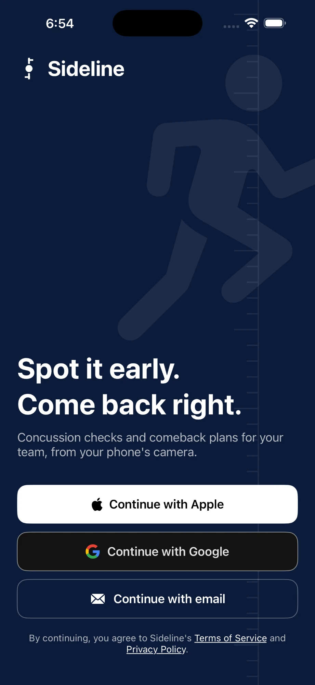
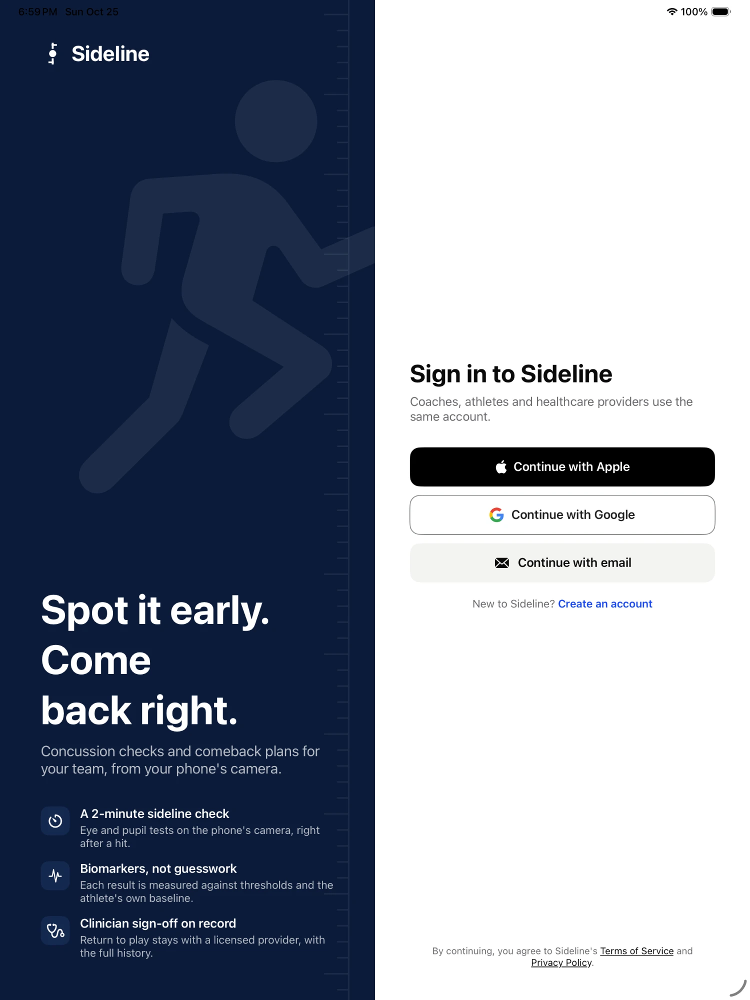
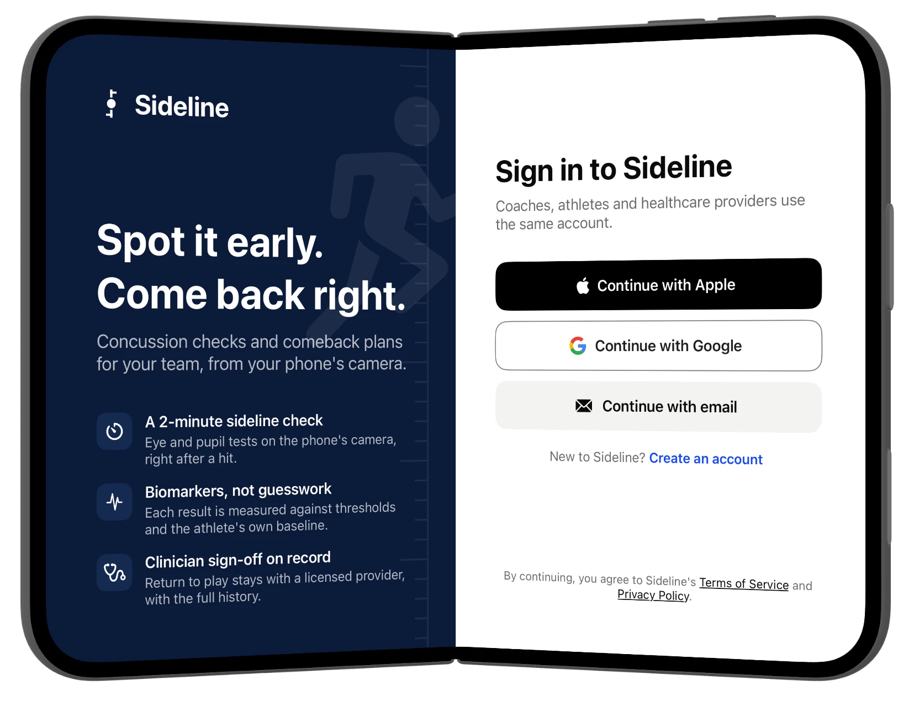

# Sideline

Concussion checks and comeback plans for teams, from the phone's camera. A coach runs a short eye and
pupil check right after a hit. The athlete takes a daily check while they recover. A healthcare provider
reviews the measurements and decides each step back to play.

Every test, biomarker and threshold comes from a knowledge graph that links what the phone senses to
the conditions it can help screen for. Sideline asks no questions about symptoms: decisions rest on
measured biomarkers against the athlete's own baseline.

## Why Sideline

Concussions on the sideline are judged mostly by asking the athlete how they feel. Athletes want to keep
playing, so they under-report, and a coach has no instrument to check against. Sideline replaces the
question with a measurement:

- **Objective, not self-reported.** No symptom questionnaires. Every decision rests on eye and pupil
  biomarkers measured by the phone's camera, which an athlete cannot talk their way past.
- **Compared with the athlete's own normal.** Each athlete records one baseline. A result is read against
  their own values, not only a population average, so a fast-eyed athlete who slows down is still caught.
- **Two minutes, one phone.** The check runs on the coach's iPhone at the sideline. No lab, goggles or
  extra hardware.
- **The same test from hit to return.** The sideline check after a hit, the daily check during recovery
  and the provider's review all use the same biomarkers, so recovery is a measured trend, not a guess.
- **Traceable science.** Each test, biomarker, threshold and rule is a node in a knowledge graph with a
  stable code and a cited source, so every number on screen can be traced to how it was measured and why
  it matters.
- **Clinician in control.** Sideline flags and measures; a licensed provider makes every return-to-play
  decision, with the full biomarker history in front of them.

## Who uses it

| Role | Device | What they do |
|---|---|---|
| Coach or instructor | iPhone, including foldable iPhone | Sees the roster, runs a sideline check after a hit, follows who is due or overdue a test |
| Athlete | iPhone | Records a baseline once, takes the daily check while recovering, sees their biomarkers |
| Healthcare provider | iPad, landscape | Works a case queue, reviews biomarker history, approves each return-to-sport step and signs off |

## Supported devices

Sideline runs on iPhone, iPad and foldable iPhone, with a layout designed for each.

| iPhone | iPad | iPhone Duo (unfolded) |
|:---:|:---:|:---:|
|  |  |  |

## The tests

Four camera tests, each with its duration from the knowledge graph:

| Test | Code | What it measures | Biomarkers |
|---|---|---|---|
| Light Response | TST-00006 | How the pupils react to light | PLR amplitude (BMK-00069), pupil asymmetry (BMK-00075) |
| Follow the Dot | TST-00002 | Eye tracking and quick eye jumps | Saccade peak velocity (BMK-00080), smooth pursuit gain (BMK-00084) |
| Hold & Look | TST-00005 | Blinking and gaze steadiness | Blink rate (BMK-00006) |
| Close-up Eye Photo | TST-00001 | The front of each eye, rear camera, for eye injuries | Saved for the clinician |

Dynamic Visual Acuity (TST-00004) runs as practice in the baseline. Its feature is planned in the catalog,
so it does not score yet.

- **Sideline check** (coach, after a hit): Light Response, Follow the Dot, Hold & Look, Close-up Eye Photo.
- **Baseline** (athlete, once): Light Response, Follow the Dot, Hold & Look, Dynamic Visual Acuity.
- **Daily check** (athlete, while recovering): Light Response, Follow the Dot, Hold & Look. About 2 minutes.

Each check walks the athlete through it: a camera-style positioning screen with a countdown, a
"Next up" card before each test, an eyes-tracked indicator, pause, and a retake when the camera
loses the eyes.

## The knowledge graph

Sideline's science lives in a typed graph, not in the app's code. Each step has one job:

```
Sensor → Test → Observation → Feature → Biomarker → Model → Condition
```

| Layer | What it is | Example |
|---|---|---|
| Sensor | Hardware on the phone | TrueDepth camera, RGB camera, eye-gaze tracking |
| Test | What the athlete does, and for how long | Follow the Dot, 75 s |
| Observation | Raw data a test records | Gaze position stream, two angles per frame at 60 Hz |
| Feature | A number computed from observations | Smooth pursuit gain, a ratio |
| Biomarker | A feature with clinical meaning: reference range, units, direction | Smooth pursuit gain, normal 0.90–1.00 |
| Model | Rules that combine biomarkers into a risk | Concussion oculomotor screen |
| Condition | What the model screens for | Concussion, traumatic brain injury, anisocoria after head injury |

Two rules keep the graph honest:
1. **Only features compute.** A biomarker references a feature and adds meaning (range, thresholds, units);
   it never does math of its own.
2. **Models reason only over biomarkers.** A model never reads raw observations or features directly,
   so every input to a decision has a defined normal range.

Every element has a stable code (TST-, OBS-, FTR-, BMK-, CND-), so a result in the app, a document in
Apple Health and a provider's report all point to the same definition.

## How biomarkers are computed

Each check records observations from the camera, computes features, and reads them as biomarkers:

| Biomarker | Test | Observation | How it's computed |
|---|---|---|---|
| Saccade peak velocity (°/s) | Follow the Dot | Gaze position stream, 60 Hz | The horizontal gaze angle is tracked frame by frame; the peak angular velocity during each quick eye jump is taken. Slower jumps point to brainstem or oculomotor disruption. |
| Smooth pursuit gain (ratio) | Follow the Dot | Gaze position stream, 60 Hz | Eye velocity divided by the dot's velocity while the dot moves at 0.4 Hz over ±15°. 1.0 means the eyes keep pace; below 1.0 means they lag and catch up with small jumps. The vergence angle between the two eyes is a second input. |
| Blink rate (/min) | Hold & Look | Eyelid images, frame by frame | Lid-margin position and eye-opening height are tracked; each close-and-open is a blink, counted over the recording window. |
| PLR amplitude (mm) | Light Response | TrueDepth pupil stream, 60 Hz | Resting pupil diameter is measured, the screen flashes full white in sync with the recording, and the peak constriction from rest is taken. |
| Pupil asymmetry (mm) | Light Response | TrueDepth pupil stream, 60 Hz | The difference between left and right resting pupil diameters. |

When a capture is incomplete or below quality (eyes not found, poor light), the feature is left empty
rather than guessed, and the check asks for a retake.

## Methodology

**1. Capture.** Each test records the eyes with the front TrueDepth camera at 60 frames per second, the
phone held about 30 cm from the face. Before recording, the app checks that a face is found, the distance
is right, the light is even and both eyes are visible. During recording it tracks whether the eyes are
still found. The Close-up Eye Photo uses the rear camera with the torch, held by the coach.

**2. Standardized stimuli.** The tests control what the eyes see, so results are comparable day to day:
the screen dark-adapts and flashes full white three times (Light Response); a dot moves sinusoidally at
0.4 Hz over ±15° (Follow the Dot); a fixed target is held for 30 seconds (Hold & Look).

**3. Quality gates.** A feature is computed only when its capture completed and met the quality threshold.
Otherwise it is left empty and the test is retaken; a value is never imputed.

**4. Feature extraction.** Per-frame observations (gaze angles, pupil diameters, eyelid position) become
one number per feature, as described in the table above.

**5. Biomarker interpretation.** Each biomarker carries a published reference range:

| Biomarker | Reference range | Source |
|---|---|---|
| Saccade peak velocity | 350–600 °/s at 10° amplitude | Leigh & Zee, *The Neurology of Eye Movements*, 5th ed., 2015 |
| Smooth pursuit gain | 0.90–1.00 at 0.4 Hz, ±15° | Lencer & Trillenberg, *Brain Cogn* 2008;68:219–28 |
| Blink rate | 12–20 per minute | Karson, *Brain* 1983;106:643–53 |
| PLR amplitude | 1.5–3.5 mm | Bremner, *Eye* 2004;18:1175–81 |
| Pupil asymmetry | below 0.4 mm | Lam et al., *Am J Ophthalmol* 1987;104:69–73 |

**6. Personal baseline.** Each result is also compared with the athlete's own baseline. A biomarker is
"at your normal" when it has returned to within 15% of the gap between the baseline and the
injury-day value.

**7. Screening model.** A rule-based model combines the oculomotor biomarkers into a risk level (below).
It is a screening aid with an expected AUC of 0.73; clinical validation is in progress, and it does not
diagnose.

## How results are decided

- **Concussion model** (`concussion-oculomotor-screen-v1`): flags saccade velocity below 350 °/s, pursuit
  gain below 0.80, gaze stabilization below 95 °/s, and blink rate below 10 or above 25 per minute.
  Three or more flags give 0.75, one or two give 0.40, none gives 0.05.
- **Emergency rule**: pupil asymmetry above 1.0 mm after a head injury (CND-00260) means call emergency services.
- **Personal baseline**: each athlete records one dated baseline. It covers every sport and team they
  play. Daily results show each biomarker as "At your normal", below normal, or past the threshold.
- **Return to sport**: six graduated steps (2022 Amsterdam consensus). A daily check back at the
  athlete's normal moves them up a step. Two clean checks in a row send a report to the provider, who
  signs before full contact and competition.

## Test schedule

The app tracks when each athlete last tested and whether a test is due:

- Recovering athletes take the daily check every day. It shows as overdue after a missed day.
- New athletes need a baseline within 7 days of joining. Baselines renew after a year.
- Coaches see due and overdue tests on the roster; the team header counts overdue tests.

## Apple Health

Athletes can connect Apple Health from their home screen or account settings.

- **Writes**: each check and the baseline are saved to Health as clinical documents (CDA). Each holds the
  five biomarkers with their catalog codes, today's value, the baseline, the threshold and the step
  decision. Find them in Health under Clinical Documents.
- **Reads**: sleep, heart rate variability, resting heart rate and workouts. Workouts are checked against
  the athlete's current step, for example heart rate kept under the step 2 limit.

## Accounts and settings

- Sign in with Apple, Google or email. New users register as a coach (creates a team and an invite code),
  an athlete (joins with a team code, with parent or guardian consent under 18), or a provider.
- Every user has an account screen: profile photo, name, notifications, privacy, help, sign out.
- Athletes pick every sport they play from 50 sports, each with its own silhouette.

## Run

```bash
xcodegen generate                 # after adding files; spec in project.yml
open Sideline.xcodeproj           # pick a simulator, press Run
```

On iPad and the unfolded iPhone Duo, coach and provider screens use a split view.

Player photos live in `pics/` as `firstname.png`; the app uses face-cropped copies in the asset catalog
named `photo-firstname`.

## Code map

- `Graph.swift`: the knowledge graph snapshot (tests, biomarkers, thresholds, the concussion model).
- `Models.swift`: accounts, teams, athletes, sessions, the store, and the test schedule.
- `CheckView.swift`: the check flow and its results.
- `RosterView.swift`, `AthleteView.swift`: the coach.
- `AthleteDashboardView.swift`: the athlete.
- `ProviderDashboardView.swift`: the provider.
- `AppleHealthView.swift`, `HealthBridge.swift`: Apple Health.
- `RoleGateView.swift`, `RegistrationView.swift`, `ProfileView.swift`: sign-in, registration, account.
- `Theme.swift`, `Avatar.swift`, `Brand.swift`: design tokens, photos, team art, brand.

## Brand

Design system PDF: `docs/brand/sideline-design-system.pdf`.
- Symbol and lockups: `Brand/*.svg`. In code: `SidelineSymbol` and `SidelineLockup` in `Sideline/Brand.swift`.
- App icon (light, dark, tinted): `Sideline/Assets.xcassets/AppIcon.appiconset`. Regenerate with
  `python3 -I Brand/make_brand_assets.py` (needs Pillow).
- Colors: navy brand, electric blue for "your normal", orange only for alerts.

## Safety language

The app never says "cleared", "safe to play" or "no concussion". It reports measurements, says
"remove from play", and records a provider's decision. Return to play stays with a qualified
healthcare provider.
